# Bearings Workbench for FreeCAD

Parametric rolling bearings for FreeCAD, made for makers. Click a hole or a shaft and get
a correctly sized **608**, **625**, **R188** or **LM8UU** that stays attached to it, or
design a fully parametric **3D-printable bearing** with races, a snap-in cage and balls.

<p align="center">
  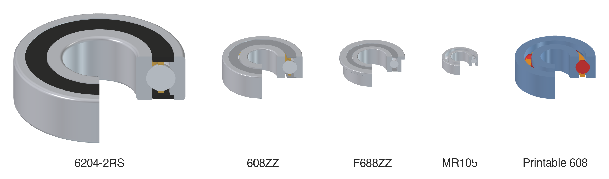
</p>

Tested with FreeCAD 1.1. Inspired by
[FreeCAD_FastenersWB](https://github.com/shaise/FreeCAD_FastenersWB).

- **Standard bearings**: deep groove series 60, 62, 63, 68, 69, MR miniatures and inch
  R sizes, with shields, seals and flanges, sized automatically from the edge you click.
- **Angular contact and thrust bearings**: 72xx B / 73xx B and 511xx.
- **Self-aligning, cylindrical, tapered and needle roller bearings**: 12 / 13 / 22 / 23,
  NU / NJ, 302 / 303 / 320, HK and NK, and AXK thrust needle assemblies.
- **Linear bushings**: LM8UU and friends, long, round-flanged and square-flanged.
- **Find bearing**: search by name, bore, outside diameter or height.
- **3D-printable bearings**: races, a snap-in cage and balls as separate PartDesign
  bodies, with a live preview while you set them up.
- **Bearing BOM**: every bearing in the document with its quantity, saved as CSV.

## Standard bearings

The **Bearings** toolbar has one drop-down button per family (deep groove, angular
contact, self-aligning, cylindrical, tapered, needle, thrust, linear); the **Bearings**
menu lists every series by family. You get a common default size (608, 625, R188, NU204,
30204, HK0810, …), and every option is a property you can change later.

| Series | What it is | Example |
|---|---|---|
| **60** | Deep groove, light | 608 (8 × 22 × 7), skateboard and 3D-printer bearing |
| **62** | Deep groove, medium | 625 (5 × 16 × 5), 6204 |
| **63** | Deep groove, heavy | 6300 |
| **68** (618) | Thin section | 688 (8 × 16 × 4) |
| **69** (619) | Thin section | 695 |
| **MR** | Metric miniature | MR105 (5 × 10 × 3) |
| **R** | Inch miniature | R188 (1/4" × 1/2" × 1/8"), fidget spinners and RC; FR188 flanged |
| **72**, **73** | Angular contact, 40° (B) | 7204B: same size as a 6204, takes axial load from one side |
| **511** | Thrust ball bearing | 51104 (20 × 35 × 10): turntables, lazy susans, axial loads |
| **12**, **13**, **22**, **23** | Self-aligning ball bearing | 1205: tolerates a shaft that isn't quite aligned |
| **NU2**, **NU3**, **NU22**, **NU23** | Cylindrical roller bearing, NU or NJ (`Variant`) | NU204: high radial loads |
| **302**, **303**, **320** | Tapered roller bearing | 30204: wheel hubs, combined loads |
| **HK**, **NK** | Needle roller bearing without inner ring | HK0810 (8 × 12 × 10): runs right on the shaft |
| **AXK** | Thrust needle roller and cage assembly, optional AS washers (`Variant`) | AXK1528 |

### Closures and flanges

**Open**, **Z** / **ZZ** (metal shields) and **RS** / **2RS** (rubber seals), with the wider
shielded width of miniature bearings where it differs (688 is 4 mm open, 5 mm as 688ZZ).
Miniature sizes also come **flanged** (F688, MF105, FR188).

<p align="center">
  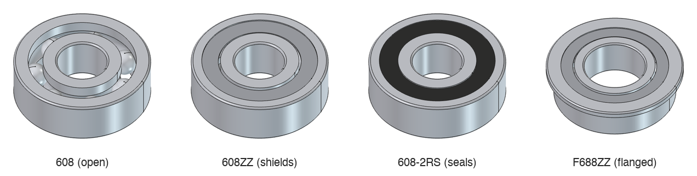
</p>

### Detail levels

- **Envelope**: one solid, fast in big assemblies.
- **Standard** (default): inner and outer ring with raceways, balls, shields or seals.
- **Detailed**: adds a cage.

<p align="center">
  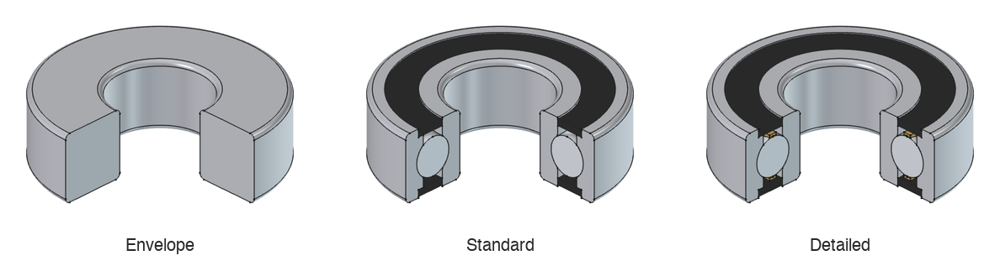
</p>

### Snap to a hole or a shaft

Select one or more circular edges, then click a series button. A hole edge gets the
bearing whose **outside diameter** matches, sitting in the hole flush with the face; a
shaft end gets the bearing whose **bore** matches, sliding onto the shaft. A little
clearance is fine: a 22.2 mm hole or a 7.98 mm shaft still gets a 608 (up to 0.5 mm by
default, set in **Bearing tools → Settings**; `FitClearance` shows it). The bearing
stays attached: move or resize the part and it follows. `Invert` flips it to the other
side of the edge and `Offset` moves it along the axis.

<p align="center">
  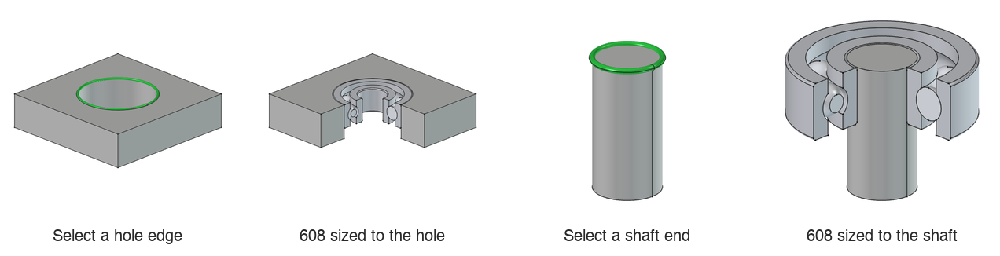
</p>

The label follows the designation (`608`, `608-2RS`) until you rename the bearing.
Further bearings of the same size are `608_001`, `608_002`, …

The tables hold only the standard boundary dimensions (ISO 15). Ball size, ball count and
raceways are computed, so the shapes are representative, not a copy of one maker's
drawing.

### Angular contact and thrust bearings

**Angular contact** bearings (72xx B, 73xx B) have the same boundary dimensions as the
62 / 63 series. Each ring has a high shoulder on one side and a low one on the other, so
the bearing carries axial load from the top. **Thrust** bearings (511xx) are two washers
with the balls between them: the shaft washer at the bottom fits the shaft, the housing
washer on top sits clear of it. Both snap to edges like the other bearings; **Detailed**
adds the cage.

<p align="center">
  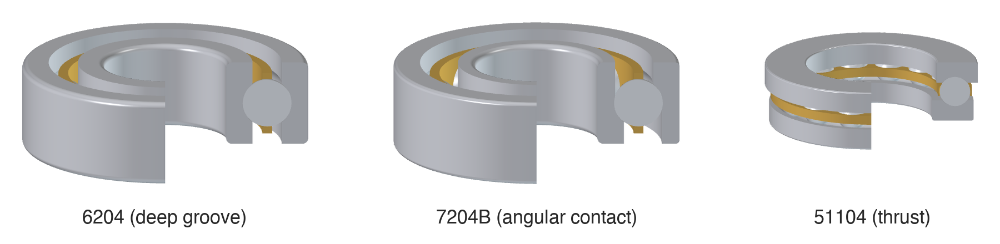
</p>

### Roller and needle bearings

**Self-aligning** ball bearings have two rows of balls on a spherical outer raceway.
**Cylindrical** roller bearings come as NU (ribs on the outer ring only, so the shaft can
move axially) or NJ (one rib on the inner ring too); switch with `Variant`. **Tapered**
roller bearings are drawn with their real geometry: cone, cup and rollers share one apex
on the axis, and the cone's back rib holds the rollers' large ends. **HK** drawn cups and
**NK** needle bearings have no inner ring: select the shaft and the needles run right on
it. **AXK** assemblies are the cage with its needles; set `Variant` to add an AS washer on
each side (the BOM then lists the washers too). Their cages aren't modelled, so Detailed
looks like Standard.

<p align="center">
  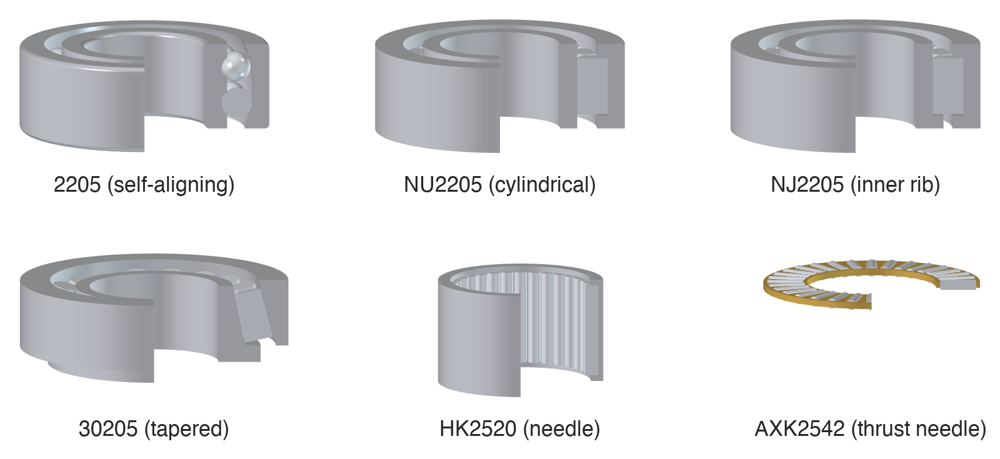
</p>

## Linear bushings

The **LM** button inserts linear ball bushings for smooth rods: **LM8UU** (8 × 15 × 24, the
3D-printer classic), the long **LM8LUU**, and the flanged **LMF8UU** (round) and
**LMK8UU** (square), with counterbored bolt holes. Sizes run from LM5UU to LM60UU. Turn
on `Flanged` and pick a `FlangeShape`.

<p align="center">
  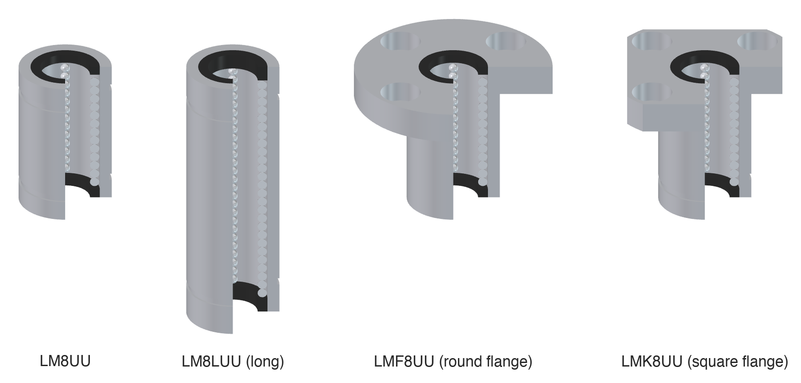
</p>

They snap like bearings: select the end of a rod and the bushing slides onto it, or select a
hole and it goes in. A flanged bushing (or flanged ball bearing) in a hole rests its
flange on the face, with only the body in the hole. Plain bushings have their retaining
ring grooves. **Standard** detail adds the seals and the plastic ball retainer with a slot
along each ball row; **Detailed** adds the balls, peeking out of the slots onto the rod.

## Find bearing

**Bearing tools → Find bearing** searches the catalog by any combination of:

- **Name**, or the start of one: `608`, `62` (all 62xx), `F688-2RS`, `MF105ZZ`, `6204-2RS1`,
  SKF-style `618/8`, `FR188ZZ`, `LMK8UU`, or a size such as `8x22` or `8x22x7`. Flange
  and closure codes in the name are used when inserting.
- **Inner diameter**, **outer diameter** and **height**, with a ± tolerance. The height
  also matches the shielded width.

<p align="center">
  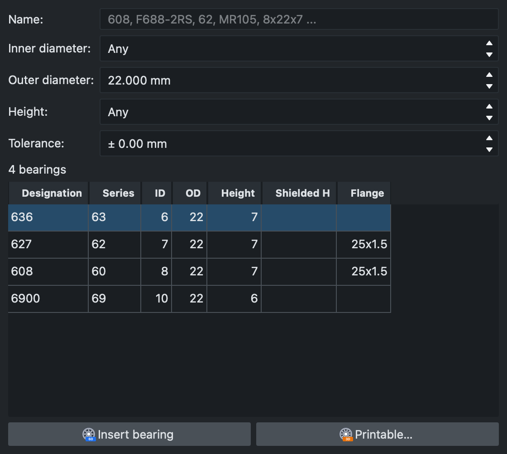
</p>

**Insert bearing** adds the selected size as a standard bearing (attached to the edges you
selected before opening the panel, if any). **Printable…** opens the 3D-printable bearing
panel with that size.

## 3D-printable bearings

**Bearing tools → 3D-printable bearing** designs a deep groove ball bearing to print: the
inner and outer races, a snap-in cage and, if you want them, the balls. Use bought steel
balls or airsoft BBs; everything else comes off the printer.

<p align="center">
  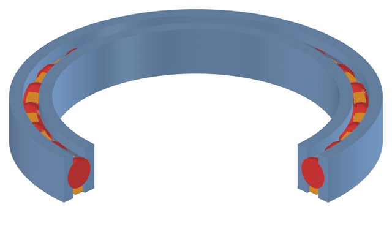
</p>

Races, cage and balls are separate PartDesign bodies, so each one exports and prints on
its own. They are ordinary PartDesign features driven by expressions, so the bearing keeps
working in FreeCAD even without the workbench installed.

<p align="center">
  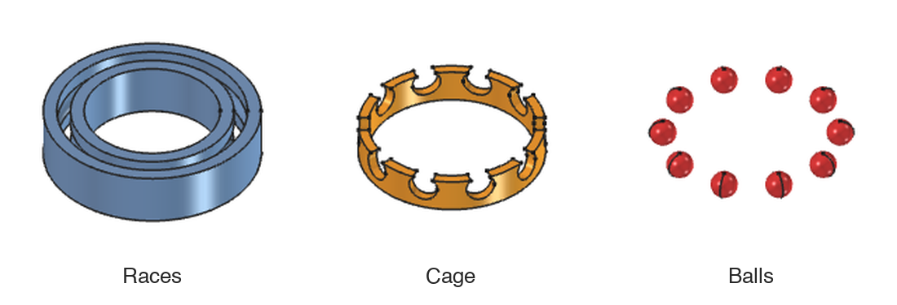
</p>

### The task panel

Select a circular edge (or nothing, to build at the origin), then run the command. The
panel opens next to the 3D view, and a **live preview** shows the bearing in place while
you edit: the inner and outer diameter as labelled rings, drawn through the part, and a
see-through view of races, balls and cage.

<p align="center">
  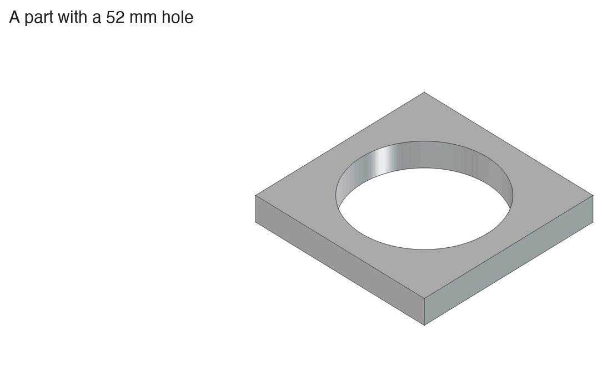
</p>

<p align="center">
  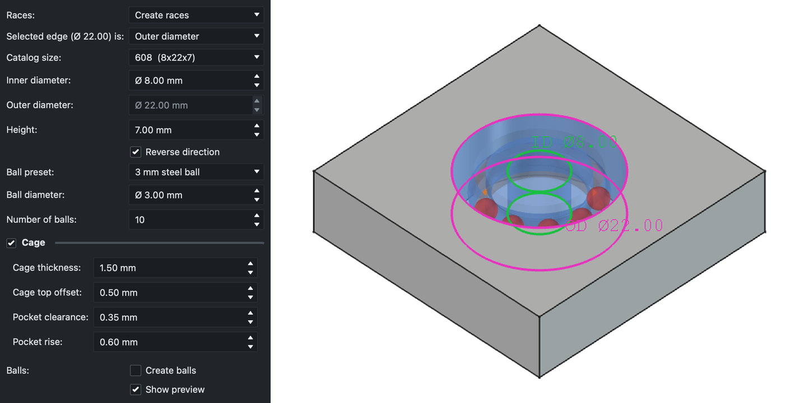
</p>

- **Catalog size** fills in ID, OD and height from a standard bearing (608, 625, 6204, …).
  With a selected edge, only sizes that fit it are listed, allowing the same clearance as
  standard bearings (a 22.2 mm hole still lists the 608).
- **Ball preset**: balls you can buy, from 3 mm and 1/8" up to 6 mm airsoft BBs (5.95 mm)
  and 1/4".
- A red **status line** says what doesn't fit, such as too many balls for the pitch
  circle. Nothing is resized behind your back.
- **Reverse direction** is preset so the bearing goes into the hole or onto the shaft.

### Three ways to start

- **Create races**: a new bearing at the selected edge (the end of a shaft, a housing
  bore) or at the origin. Races, cage and balls go into one Part named after the size,
  e.g. **Bearing 608 (22x8x7)**; move the Part to move the bearing.
- **Groove selected body**: select the bore (or outer surface) of a PartDesign body, and
  the ball groove is cut into it. Your part *is* the outer race; a thin inner race splits
  off. Great for pulleys, wheels and gears with the bearing built in.

  <p align="center">
    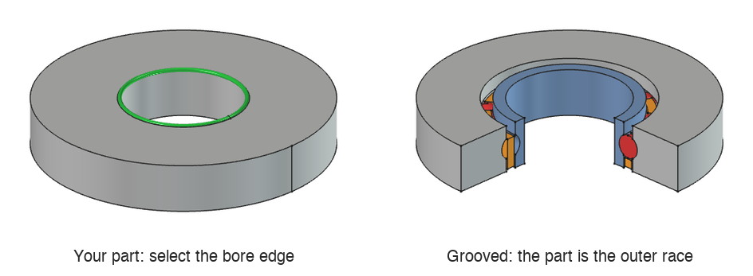
  </p>

- **Replace a standard bearing**: select a standard bearing and run the command. The
  printable bearing takes its size and place, and the standard one is hidden.

  <p align="center">
    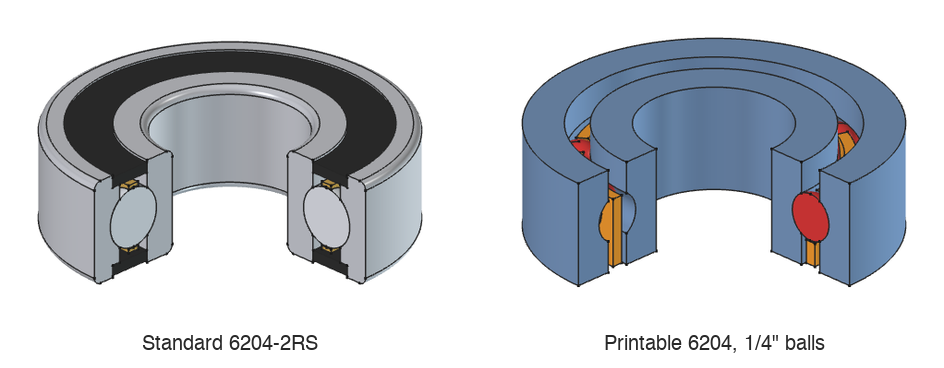
  </p>

### Changing it later

Every value lives on the **BearingParameters** datum in the races body: ID, OD, height,
ball diameter, number of balls, and the cage's thickness, top offset, pocket clearance and
pocket rise. Select it in the tree and edit the properties; races, cage and balls update.
For new races, the **PrintableBearing** object next to the bodies keeps the Part's label
in step with the size and flags values that don't work.

The design comes from the
[DeepGrooveBallBearing macro](https://github.com/PraveenKum11/freecad-deep-groove-ball-bearing),
printed and tested in real projects. The macro is still available for printing bearings
without the whole workbench.

## Bearing BOM

**Bearing tools → Bearing BOM** lists every bearing in the document with its quantity:
standard bearings and bushings by full designation (copies made with App::Link and link
arrays included), printable bearings by size, and the balls the printable bearings need,
so you know what to buy. Hidden objects, such as a standard bearing you replaced with a
printable one, are skipped unless you untick **Skip hidden objects**. **Save CSV…** writes
the list for a spreadsheet.

<p align="center">
  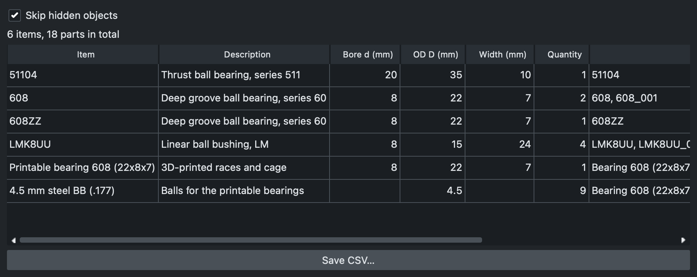
</p>

## Install

Until the workbench is in the Addon Manager, install it by hand: put this repository in
FreeCAD's `Mod` folder as `Bearings` and restart FreeCAD.

```sh
git clone https://github.com/PraveenKum11/FreeCAD_BearingsWB.git Bearings
```

In FreeCAD, `App.getUserAppDataDir()` in the Python console shows the base folder, for
example `~/Library/Application Support/FreeCAD/v1-1/` on macOS or
`~/.local/share/FreeCAD/v1-1/` on Linux; `Mod` is inside it. Then pick **Bearings** in the
workbench selector.

For development, link your clone instead of copying it (run from the repository root):

```sh
ln -s "$PWD" "$HOME/Library/Application Support/FreeCAD/v1-1/Mod/Bearings"
```

## Scripting

```python
import BearingBase

b = BearingBase.make_bearing("60", "608", Closure="2RS", DetailLevel="Detailed")
```

## Data sources and accuracy

The tables in `BRData/` hold only boundary dimensions: bore, outside diameter, width,
corner radius, and the shielded width, flange, groove and bolt-hole sizes where they
apply. Everything inside a bearing (ball size and count, raceways, cage) is computed, and
no load ratings, speeds or other catalogue data are included.

| Table | Where the dimensions come from | Cross-checked against |
|---|---|---|
| Series 60, 62, 63, 68, 69 (`iso15_*.csv`) | ISO 15 boundary dimensions; shielded widths and flanges from common miniature listings | [SKF's public deep groove ball bearing table](https://www.skf.com/group/products/rolling-bearings/ball-bearings/deep-groove-ball-bearings): every size SKF sells matches, and corner radii were checked per bearing |
| MR miniatures (`mr.csv`) | Common metric miniature listings (Minebea/NMB naming) | SKF's table for the closed widths |
| Thrust 511 (`thrust_511.csv`) | ISO 104 boundary dimensions, dimension series 11 | SKF's public thrust ball bearing table: every row matches |
| Series 22, 23 (`iso15_22.csv`, `iso15_23.csv`) | ISO 15 dimension series 22 / 23 | SKF's self-aligning and cylindrical roller tables |
| Self-aligning 12 / 13, cylindrical NU2 / NU3 / NU22 / NU23 | Taken from the 62 / 63 / 22 / 23 tables (ISO 15 shares the boundary dimensions) | SKF's self-aligning and cylindrical roller tables: all sizes match |
| Tapered 302 / 303 / 320 (`tapered.csv`) | ISO 355 boundary dimensions | d, D, T: SKF's tapered roller table; cone and cup widths: the [PTI](https://pti.eu/pdf/lejer/taperoller/30200.pdf) and [BKZ](https://bkzindustry.com/blogs/tapered-roller-bearing-size-chart/) tables |
| Needle HK / NK, AXK (`needle.csv`, `axk.csv`) | Common needle bearing dimensions | SKF's needle roller and needle thrust tables (all but HK0708, which SKF doesn't list) |
| Angular contact 72 / 73 | Taken from the 62 / 63 tables (ISO 15 gives them the same boundary dimensions) | SKF's angular contact table: all 41 B sizes match |
| Inch R (`inch_r.csv`) | ABMA inch dimensions, converted exactly (× 25.4) | SKF's table (R144, R166, R188, R3–R12) and the [MKL miniature bearing size chart](https://www.mklbearing.com/blog/miniature-bearing-size-chart_b54) (all sizes, FR flanges) |
| LM linear bushings (`linear_lm.csv`) | The interchangeable "Asian standard" LM dimensions, from [Samick's linear bushing catalog](https://www.findling.com/fileadmin/Inhalt/PDFs/Kataloge/Samick_Linear_Bushing.pdf) (plain, long, LMF, LMK) | [G2k's LM table](https://www.euro-bearings.com/g2klm.htm) (plain) and [Tuli's LMK-LUU sheet](https://www.tuli-shop.com/media/custom/upload/LMK-LUU-Linear-Bearings.pdf) (square flange) |

The details of each check, including the few values where sources disagree and which one
we use, are in [PLAN.md](PLAN.md) §4.

Shielded widths and flange dimensions of miniature bearings vary by vendor and are
approximate: check `BRData/*.csv` against your supplier's sheet before relying on them for
tight fits. The tables are plain CSV, so they are easy to correct.

## Development

The roadmap and design decisions are in [PLAN.md](PLAN.md). The user documentation is the
GitHub wiki, kept in [`docs/`](docs/) and published by the `Publish wiki` workflow.

Headless tests (`unittest`, run inside FreeCAD's own Python, about 2 minutes):

```sh
path/to/freecadcmd tests/run_tests.py
BEARINGS_TESTS=test_printable path/to/freecadcmd tests/run_tests.py   # one module
```

On macOS `freecadcmd` is in `FreeCAD.app/Contents/Resources/bin/`.

GUI smoke test (needs the workbench installed; opens and closes FreeCAD by itself):

```sh
FREECAD=path/to/FreeCAD tests/gui/run_gui.sh tests/gui/gui_smoke.py /tmp/smoke.log
```

Code style uses [Ruff](https://docs.astral.sh/ruff/), configured in `pyproject.toml`:

```sh
ruff format . && ruff check .
```

`path/to/freecadcmd tools/make_icons.py` regenerates `Icons/*.svg` from the workbench's
own shapes. `path/to/FreeCAD tools/render_images.py` regenerates the images in this README
from the workbench's own code (it needs the FreeCAD GUI, not `freecadcmd`).

## License

GPL-3.0-or-later, see [LICENSE](LICENSE).
